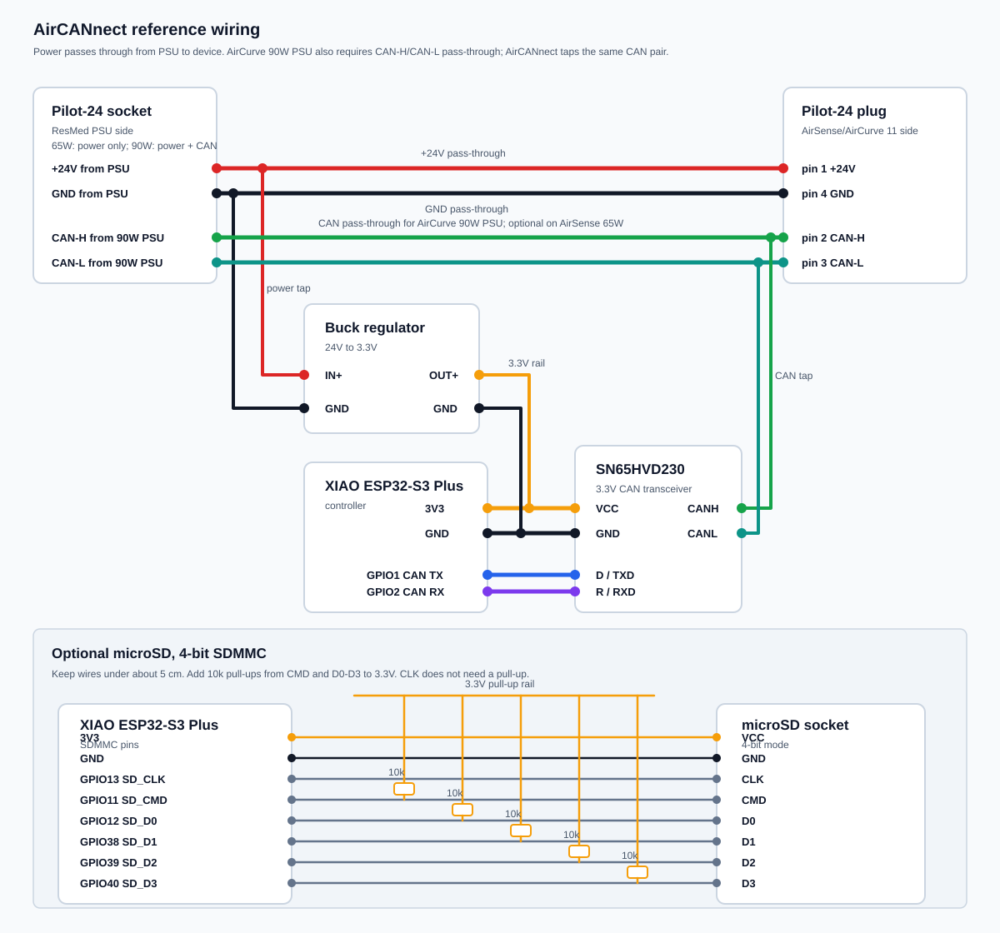

# AirCANnect Hardware

Build notes for supported ESP32-S3 targets. AirCANnect assumes PSRAM and
microSD storage. CAN and BLE are independent build capabilities; a board may
provide either or both.

The microSD card provides first-boot provisioning, EDF capture, reports, file
logging, and the ResMed firmware repository.

## Choose a hardware path

| Board | microSD | ResMed connection | Local features |
| --- | --- | --- | --- |
| [**Waveshare ESP32-S3-Touch-LCD-1.54**](https://docs.waveshare.com/ESP32-S3-Touch-LCD-1.54) | Onboard, 4-bit SDMMC | **BLE** | LCD, buttons, automatic rotation, speaker alerts |
| [**Waveshare ESP32-S3-GEEK**](https://docs.waveshare.com/ESP32-S3-GEEK) | Onboard, 4-bit SDMMC | **BLE**, CAN | LCD, configurable button |
| [**XIAO ESP32-S3 Plus**](https://wiki.seeedstudio.com/xiao_esp32s3_getting_started/) | External, 4-bit SDMMC or SPI | BLE, **CAN** | - |

The default connection is **bold**. BLE pairing is available in the setup
wizard. Boards with onboard microSD need no external wiring for BLE use.
AirMini requires CAN. See [Wiring tips](#wiring-tips) for external SD wiring.

## XIAO CAN wiring

Default wiring for the `xiao-esp32s3-plus-sdmmc4` profile:



AirCANnect sits in-line between the ResMed PSU and the AirSense. +24 V
and GND pass through to the AirSense; AirCANnect taps them locally for
the buck regulator.

Signal summary:

| From | To |
|---|---|
| PSU +24 V | AirSense `+24V` and buck `Vin` |
| PSU GND | AirSense `GND`, buck `GND`, XIAO `GND`, transceiver `GND` |
| PSU `CAN-H` / `CAN-L` | AirCurve `CAN-H` / `CAN-L` pass-through *(90 W PSU only)* |
| Buck 3.3 V output | XIAO `3V3` and transceiver `VCC` |
| XIAO GPIO1 CAN TX | Transceiver `D` / `TXD` |
| XIAO GPIO2 CAN RX | Transceiver `R` / `RXD` |
| Transceiver `CANH` | AirSense `CAN-H` |
| Transceiver `CANL` | AirSense `CAN-L` |

For microSD connections, see the [pin assignments](#xiao-esp32-s3-plus-pin-assignments)
and [Wiring tips](#wiring-tips).

## AirSense 11 power-and-CAN connector

The CAN cable needs a mating Air11 connector. AirMini uses the same connector,
pinout, and wiring.

For AirSense 11 with the 65 W PSU, PSU-side CAN is optional.
For AirCurve 11 with the 90 W PSU, the PSU identification uses CAN bus
and the cable uses all four connector pins. CAN-H and CAN-L must pass through
from the PSU connector to the AirCurve connector, and the AirCANnect CAN
transceiver must tap that same pass-through CAN pair.

For a suitably rated 90 W AC supply without CAN identification, the optional
[`psu_90w` setting](configuration.md#as11-connection) can supply that
identification. Leave it off when the original PSU already sends CAN messages.

**Pinout (device side):**

| Pin | Signal |
|---|---|
| 1 | GND |
| 2 | CAN-L |
| 3 | CAN-H |
| 4 | +24 V |

**Sourcing.** The original plug and socket are custom OEM parts. The
most practical source is salvaging a Pilot-24 cable kit ([Amazon
B0B3F7ZY65](https://www.amazon.com/dp/B0B3F7ZY65)) - you need both
ends, since AirCANnect sits between the PSU and AirSense: the socket
takes the PSU, the plug goes into AirSense, and the bridge wiring
runs between them. See [airbreak-plus AS11 CAN connection
notes](https://github.com/m-kozlowski/airbreak-plus/blob/master/docs/as11/can_connection.md)
for photos and additional context.

## Power

All listed boards can be powered over USB, including when using CAN. The
transceiver still needs 3.3 V power and a common ground with the board and
ResMed device. Never connect the ResMed 24 V supply directly to an ESP32 board.

For the XIAO assembly shown above, 24 V from the ResMed supply feeds a
step-down regulator that produces 3.3 V. Reference part:
[SparkFun COM-18357 (AP63203 buck)](https://www.sparkfun.com/products/18357) -
small, comfortable headroom for the ESP32-S3 + BLE peak draw. Any 24 V to
3.3 V buck with >=1 A capability works; no hard requirement on the specific
part.

Keep the 24 V and GND wires from the ResMed supply to the buck under 1 m,
using 22-24 AWG wire.

## CAN transceiver

A 3.3 V CAN transceiver sits between the ESP32 TWAI pins and the AS11 bus.
Reference part: a generic **SN65HVD230** break-out board - the small blue
PCBs sold everywhere as "CAN bus module" or similar. Any 3.3 V high-speed
CAN transceiver works; no hard requirement on the specific part or board.

See the [signal table](#xiao-can-wiring) for transceiver connections.
Use the CAN GPIOs listed for your board below.

## XIAO ESP32-S3 Plus pin assignments

These are the defaults for the `xiao-esp32s3-plus-sdmmc4` build.
Override at build time via `build_flags` if you wire differently.

```text
CAN
  TX (to transceiver D/TXD)    GPIO 1
  RX (from transceiver R/RXD)  GPIO 2

microSD (4-bit SDMMC)
  CLK     GPIO 13
  CMD     GPIO 11
  D0      GPIO 12
  D1      GPIO 38
  D2      GPIO 39
  D3      GPIO 40
```

The `xiao-esp32s3-plus-spisd` profile supports SPI-mode SD modules with
`CS` GPIO 10, `SCK` GPIO 13, `MISO` GPIO 12, and `MOSI` GPIO 11.

## Waveshare ESP32-S3-Touch-LCD-1.54

The `waveshare-esp32s3-touch-lcd-1-54` profile uses the board's 16 MB flash,
8 MB PSRAM, native USB CDC, and onboard microSD slot:

```text
microSD (4-bit SDMMC)
  CLK     GPIO 16
  CMD     GPIO 15
  D0      GPIO 17
  D1      GPIO 18
  D2      GPIO 13
  D3      GPIO 14
```

It defaults to `as11_transport=ble`, so pairing is completed from onboarding
or the Config tab. The LCD shows time, Air11, Wi-Fi, and export status while
idle, with additional pages for the latest night and 30-day summary. During
therapy it shows elapsed time, algorithm pressure, fresh oximetry when
available, and a second page of current respiratory values. BOOT and PLUS move
between pages. PWR toggles the backlight on a short press and starts or stops
therapy on a long press. Touch is not initialized.

To add CAN, a custom environment can extend this profile, remove its
inherited `-DAC_CAN_ENABLED=0` with `build_unflags`, then set
`AC_CAN_ENABLED=1`, `AC_CAN_TX_GPIO`,
`AC_CAN_RX_GPIO`, and the appropriate timing after an external transceiver
has been wired. Choose pins not already used by the board's peripherals.

## Waveshare ESP32-S3-GEEK

The `waveshare-esp32s3-geek` profile uses 16 MB flash, 2 MB quad PSRAM,
native USB, and the onboard microSD slot.

```text
CAN (external 3.3 V transceiver)
  TX (to transceiver D/TXD)    GPIO 16
  RX (from transceiver R/RXD)  GPIO 17

microSD (4-bit SDMMC)
  CLK     GPIO 36
  CMD     GPIO 35
  D0      GPIO 37
  D1      GPIO 33
  D2      GPIO 38
  D3      GPIO 34
```

The default is `as11_transport=ble`; select `can` in configuration after
wiring a transceiver. No firmware change is needed. GPIO16/17 connect to
the transceiver's logic pins, not directly to CAN-H/CAN-L.

## Wiring tips

CAN at 1 Mbit/s and 4-bit SDMMC at 40 MHz both suffer from sloppy wiring.
Practical targets:

**CAN bus.**

- ESP32 to transceiver: keep under 10 cm. Perfboard or short jumpers.
- Transceiver to AS11 connector: under 1 m. Twisted pair for `CANH` /
  `CANL` past ~30 cm.
- CAN spec wants **120 Ohm across `CANH` / `CANL` at each physical end**
  of the bus. The AS11 terminates its own end internally; the transceiver
  side terminates the other. Most generic SN65HVD230 break-out boards
  already include a 120 Ohm resistor (sometimes with a removable jumper) -
  leave it in. If your board does not have one, add it.

**External microSD wiring (XIAO).** At 40 MHz:

- Use soldered connections; breadboards are unsuitable for regular use.
- Short wires only - under 5 cm from each SD pin to the GPIO. Socket
  choice matters less than how short you wire it.
- Avoid the long (20 cm) Dupont jumpers - they cause intermittent
  card-not-detected and CRC errors.
- The SD spec requires pull-ups on `CMD` and `D0`-`D3`. ESP32-S3
  internal pull-ups (~45 kOhm) are marginal at SDMMC speed - add external
  **10 kOhm pull-ups to 3.3 V** on `CMD` and each `D0`-`D3` line. `CLK`
  does not need one.

For first-boot, flash, and CAN-link test steps, see
[quickstart.md](quickstart.md).
